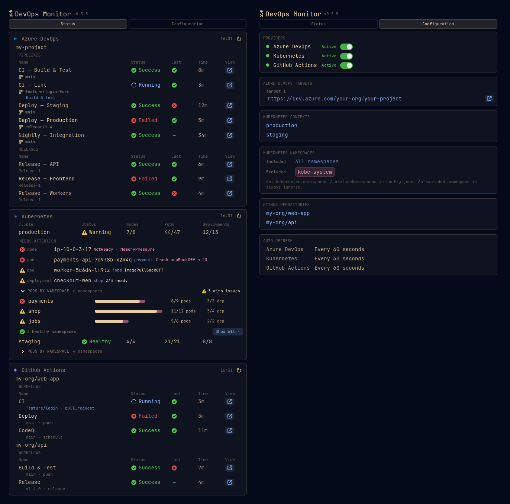

# DevOps Monitor



An [Omarchy](https://omarchy.org/) bar plugin that gives you a single, always-visible status view of your delivery stack: **Azure DevOps** pipelines and releases, **Kubernetes** cluster health and **GitHub Actions** workflows, without leaving your desktop.

| Provider | What it shows | Needs |
|----------|---------------|-------|
| **Azure DevOps** | Latest run of each pipeline (status, previous run, duration, branch) and the state of each release | `az` CLI + `azure-devops` extension, signed in with `az login` |
| **Kubernetes** *(optional)* | Health of each context: nodes, pods and deployments ready; what is failing (pod, reason, restarts); pods per namespace, with an optional namespace filter | `kubectl` + kubeconfig |
| **GitHub Actions** *(optional)* | Latest run of each workflow of the repositories you list (status, previous run, duration, branch) | GitHub CLI (`gh`) signed in with `gh auth login` |

Each provider can be turned on or off independently, has its own refresh timer and never stores credentials.

## Why DevOps Monitor?

When you are working across multiple terminals, editors, and browser tabs, switching to the Azure DevOps portal, GitHub or `k9s` just to check if a pipeline passed breaks your flow. DevOps Monitor puts that information in the Omarchy bar — always visible, one click away.

It is not a replacement for Azure DevOps, GitHub or `k9s`. It is a status layer that tells you at a glance whether everything is green so you can stay focused, or whether something needs your attention so you can go investigate with the right tool.

**What it answers:**
- Did my last pipeline or workflow run pass or fail, and on which branch?
- Is the previous run history consistent?
- Did my last release succeed?
- How long did each pipeline take?
- Is my Kubernetes cluster healthy, and if not, which pod, node or deployment is the problem?
- Did the latest run of each GitHub Actions workflow pass?

**What it does not do:**
- It does not let you trigger or cancel pipelines, workflows or releases.
- It does not replace the Azure DevOps or GitHub web interfaces for detailed logs.
- It does not replace `k9s` for cluster management.

---

## Bar Widget

The plugin icon in the bar shows an overall status dot that combines every enabled provider:

| Display | Meaning |
|---------|---------|
| `󰓋 +` | All providers healthy |
| `󰓋 !` | Warning — at least one pipeline or workflow failed, or a provider is offline |
| `󰓋 x` | Critical failure |

- **Left-click** — open the DevOps Monitor panel
- **Right-click / Middle-click** — refresh immediately

---

## Panel

The panel has two tabs: **Status** (live data of every enabled provider, one card per provider) and **Configuration** (provider switches, Azure DevOps targets, Kubernetes contexts, GitHub repositories and refresh intervals).

```
DevOps Monitor                          16:41  ↺ Refresh

Azure DevOps                                         ↻
  omarchylabs

    PIPELINES
    Name                  Status       Last  Time   View
    CI — Build & Test     ✓ Success    ✓     8m     ↗
      main
    Deploy — Production   ✕ Failed     ✓     5m     ↗
      release/1.4

    RELEASES
    Name          Status       Last  Time   View
    DEMO RELEASE  ✕ Failed     ✕     6m     ↗
    Release-2

Kubernetes                                           ↻
  Cluster       Status     Nodes   Pods    Deployments
  production    ⚠ Warning  7/8     44/47   12/13
    NEEDS ATTENTION
    ✕ node  ip-10-0-3-17  NotReady · MemoryPressure
    ✕ pod   payments-api-7d9f8b-x2k4q  payments  CrashLoopBackOff ↻ 23
    ⚠ pod   worker-5c6d4-lm9tz         jobs      ImagePullBackOff
    › PODS BY NAMESPACE  6 namespaces              ⚠ 3 with issues

GitHub Actions                                       ↻
  my-org/web-app
    Name          Status       Last  Time   View
    CI            ✓ Success    ✓     2m     ↗
      main
```

Status values are drawn as icons (see [Status icons](#status-icons)); the text above is only a sketch.

### Columns

Pipelines, releases and GitHub workflows share the same columns:

| Column | Description |
|--------|-------------|
| **Name** | Pipeline, release or workflow name. Pipelines show the **branch** of the run below the name, in smaller text (workflows show `branch · event`); for releases the specific release name (e.g. Release-2) is shown there instead. |
| **Status** | Current run status: `✓ Success`, `● Running`, `✕ Failed`, `○ Unknown` |
| **Last** | Previous run status as a symbol — lets you spot a pattern (e.g. failed twice in a row) |
| **Time** | Duration of the current run in minutes |
| **View** | Link icon that opens the pipeline, release or workflow run directly in the browser |

Kubernetes clusters use their own columns: **Cluster**, **Status** (`Healthy` / `Warning` / `Offline`), **Nodes**, **Pods** and **Deployments** ready.

### Kubernetes details

- **Needs attention** appears under a cluster when something is not healthy. It names the node, pod or deployment, its namespace, the reason (`CrashLoopBackOff`, `ImagePullBackOff`, `OOMKilled`, `Evicted`, `Pending`, `NotReady`, a node under memory/disk pressure, ...) and the restart count. Failed items are red, items that are not ready yet are yellow.
- **Pods by namespace** is collapsed by default and shows how many namespaces have problems. Click it to see only the namespaces with problems; **Show all** opens the full list (problems first) in a fixed-height area with its own scroll, so a cluster with dozens of namespaces never makes the panel grow.
- To watch only some namespaces, set `kubernetes.namespaces` (include) and/or `kubernetes.excludeNamespaces` (exclude; wins over include) in `config.json`. The Configuration tab shows the active filter.

### Release status

Release status is derived from the **environment (stage) status**, not the top-level release status. The Azure DevOps API keeps releases as `active` even when a stage is rejected. The plugin fetches the full release detail and checks each stage — if any stage is `rejected` or `failed`, the release shows `✕ Failed`.

### Scrolling

The panel scrolls vertically when there are more pipelines than fit in the visible area. Use the mouse wheel or touchpad to scroll.

### Status icons

Each pipeline, workflow and cluster state has its own drawn icon (check, cross, spinning ring, warning triangle, ...); see [`docs/setup.md`](docs/setup.md) for the full list.

### Refresh

Each provider refreshes on its own timer, set by `refresh.azureDevOps` / `refresh.kubernetes` / `refresh.github` in `config.json` (seconds; default 60, minimum 30, maximum 3600). Click the refresh icon (↻) next to a provider's name on the **Status** tab to refresh only that provider; right-click the bar icon to refresh all of them. The icon spins while refreshing and the header shows `Refreshing...`. The time next to each icon is that provider's last refresh. A provider that is disabled is hidden from the Status tab.

### Enable / disable providers

On the **Configuration** tab, use the switch next to a provider to enable or disable it. The choice is saved to `providers.<name>` in `config.json` (only that one value is changed). If `config.json` is a symlink the panel will not write to it and shows an error instead — edit the file manually in that case.

---

## Installation

```bash
omarchy plugin add https://github.com/heinsk/omarchy-devops-monitor.git --enable
```

Or manually:

```bash
cp -a devops-monitor ~/.config/omarchy/plugins/io.github.heinsk.devops-monitor
omarchy plugin enable io.github.heinsk.devops-monitor
omarchy-restart-shell
```

---

## Configuration

`~/.config/omarchy/plugins/io.github.heinsk.devops-monitor/config.json`

```json
{
  "providers": {
    "azureDevOps": true,
    "kubernetes": false,
    "github": false
  },
  "azureDevOps": {
    "top": 50,
    "targets": [
      {
        "organization": "https://dev.azure.com/your-org",
        "project": "your-project"
      }
    ]
  },
  "kubernetes": {
    "contexts": ["production"],
    "namespaces": [],
    "excludeNamespaces": ["kube-system"]
  },
  "github": {
    "repos": ["your-user/your-repo"]
  },
  "development": {
    "mockData": false
  }
}
```

Multiple projects and organizations are supported — add more entries to `targets`.

---

## Requirements

### Azure DevOps

The plugin reads your existing Azure CLI session: it needs the Azure CLI (`az`) with its `azure-devops` extension, and you must be signed in with `az login`. It never stores credentials. Installation and sign-in steps are in [`docs/setup.md`](docs/setup.md#3-connect-azure-devops).

### Kubernetes (optional)

Needs `kubectl` installed and a configured kubeconfig; the plugin only reads the contexts you list. See [`docs/setup.md`](docs/setup.md#4-connect-kubernetes-optional).

### GitHub Actions (optional)

Uses the official GitHub CLI (`gh`) that you already have logged in; no token is stored by the plugin. Install `github-cli` with your package manager, run `gh auth login`, list the repositories to monitor in `github.repos` (up to 20, `"owner/repo"`) and turn on `providers.github` from the Configuration tab. The panel shows the latest run of every workflow of each repository. See [`docs/setup.md`](docs/setup.md) for the step-by-step guide.

---

## Development

Enable mock data to develop without real infrastructure:

```json
{ "development": { "mockData": true } }
```

Test scripts directly:

```bash
python3 scripts/azure_devops.py --mock | python3 -m json.tool
python3 scripts/kubernetes.py   --mock | python3 -m json.tool
python3 scripts/github_actions.py --mock | python3 -m json.tool
```

---

## Docs

| File | Description |
|------|-------------|
| [`docs/setup.md`](docs/setup.md) | Full setup guide including Kubernetes and GitHub Actions |
| [`docs/configuration.md`](docs/configuration.md) | All configuration options |
| [`docs/providers.md`](docs/providers.md) | Data shapes and provider details |
| [`docs/architecture.md`](docs/architecture.md) | How the plugin works internally |
| [`docs/testing.md`](docs/testing.md) | Testing guide |

---

## Security

- No credentials are stored by the plugin.
- Authentication delegates entirely to existing CLI sessions (`az`, `kubectl`, `gh`).
- All subprocess output is treated as untrusted input.
- Cluster data is read in bounded pieces: Kubernetes lists are fetched page by page (`kubectl get --raw`, 50 objects per request), each page is size-capped, every object is reduced to a few short fields as soon as it arrives, and the `kubectl` process runs with a 1 GiB memory limit. A cluster with huge annotations cannot make the plugin (or `kubectl`) exhaust memory.
- Scripts run with your user permissions — review the code before installing.

---

## Remove

```bash
omarchy plugin remove io.github.heinsk.devops-monitor
```

---

## License

MIT
